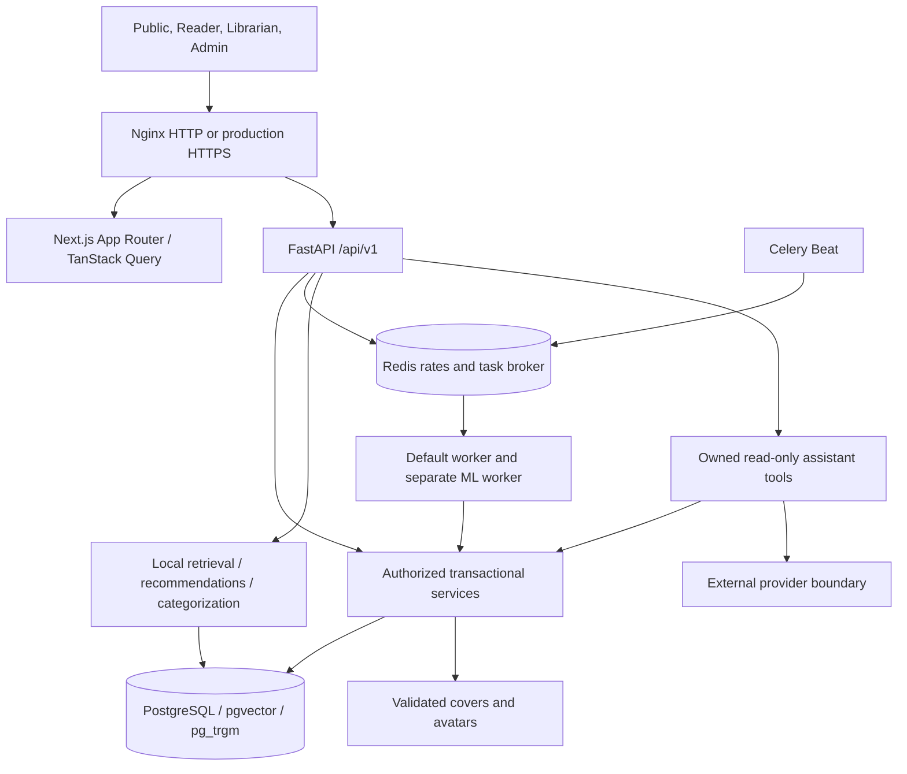

# Architecture

The original Next.js/FastAPI modular-monolith architecture is preserved. The
Master Specification remains authoritative. This document describes implemented
boundaries; historical phase reports record their introduction and verification.

## Actual source layout

- frontend/app: public/Reader route groups, Librarian/Admin layouts and shared account pages.
- frontend/features: auth, catalog/search, reservations, circulation, Reader,
  Librarian, Admin, recommendations, categorization, assistant, analytics and reports.
- frontend/components: shared Button/BookCard; feature-specific reusable components
  remain with their feature. services/api-client owns typed requests and sessions.
- backend/app/api/v1/routes: HTTP validation and explicit permission entry points.
- backend/app/services: auth, catalog/copies, reservations, borrowings (including
  physical returns/loss), users, administration, analytics/reports, audit and notifications.
- backend/app/repositories: parameterized SQLAlchemy queries and bounded aggregation.
- backend/app/db: 27 models, operator tools and repeat-safe development seeds;
  backend/alembic: five versioned migrations, no startup create_all/migration.
- backend/app/ai: embeddings, recommendations, categorization and assistant.
- backend/app/storage and workers: image boundary and restart-safe background jobs.
- ml/data and evaluation: versioned datasets, reproducible metrics/benchmark script;
  generated model weights stay in ignored caches or named volumes.
- tests/e2e and tests/deployment: real domain browser flows and production TLS.
- infra/nginx, scripts and docs: ingress, operator/verification tools and contracts.

Unused empty phase-one package markers were removed during final review. Working
services were not moved or replaced. UI modules reuse services rather than
duplicating backend eligibility/state rules.

## Data and transaction ownership

BOOK is bibliographic; BOOK_COPY is scarce physical inventory. Availability is a
SQL aggregation of current copy state. The shared FIFO allocator is used by
reservation creation/cancellation, return, catalog repair and scheduled expiration.
Transactions lock Book, sorted affected Users and dependent reservation/loan/copy
records, then recheck status/settings before committing. Uniqueness/composite
constraints add a second protection against double assignment/issue.

Settings are an uncached typed database snapshot per operation. UTC timestamps
and LIBRARY_TIMEZONE define deadlines/report dates. Services write safe audit and
notification events inside their domain transaction. PostgreSQL uniqueness makes
retries durable; Redis locks alone never protect physical-copy correctness.

## Authentication and frontend state

Argon2id and rotating hashed refresh families are shared across all roles. Access
JWTs live in memory; backend Principal checks live family/account/role status.
Frontend Web Locks serialize cookie refresh across tabs; broadcasts and identity
changes clear query caches. Same-origin Nginx simplifies CSRF/CORS. Protected
layouts aid navigation, while every private API independently authorizes requests.

Pydantic/OpenAPI generate TypeScript contracts. The central client handles CSRF,
refresh, cancellation, safe errors and authenticated binary downloads. TanStack
Query caches server state; mutations invalidate affected circulation/catalog data.
Kazakh locale resources, loading/empty/errors and confirmations are shared patterns.

## AI, reporting and workers

Local E5 vectors use immutable model/revision/dimension/source provenance and real
pgvector distance. Lexical/fuzzy, RRF hybrid, recommendation, classical ML and
external LLM orchestration are distinct mechanisms. Categorization never writes
final categories without review. The LLM receives controlled safe tool results,
never database credentials or arbitrary user selection. Missing external keys
affect only assistant inference. See AI_ARCHITECTURE.md for measured limitations.

SQL analytics and PDF/XLSX reports share dates, availability and overdue predicates.
Recharts renders returned real metrics. Two Celery queues separate expensive model
inference from bounded circulation/reminder tasks; Beat schedules reconciliation.
Late acknowledgements/retries and database event uniqueness support worker restart.

## Deployment

Eight default services: frontend, backend, postgres, redis, worker, ml-worker,
beat and nginx. Operator/database-tests profiles are explicit. Runtime and dev
images have separate tags; workers reuse the backend image. Only Nginx publishes
ports; PostgreSQL/Redis attach solely to the private data network. Production
override adds TLS/HSTS and strict origin configuration; application processes are
non-root. Backups are separate pg_dump/image/artifact exports, not volume claims.
See DEPLOYMENT.md, PRODUCTION_DEPLOYMENT.md and BACKUP_RECOVERY.md.
