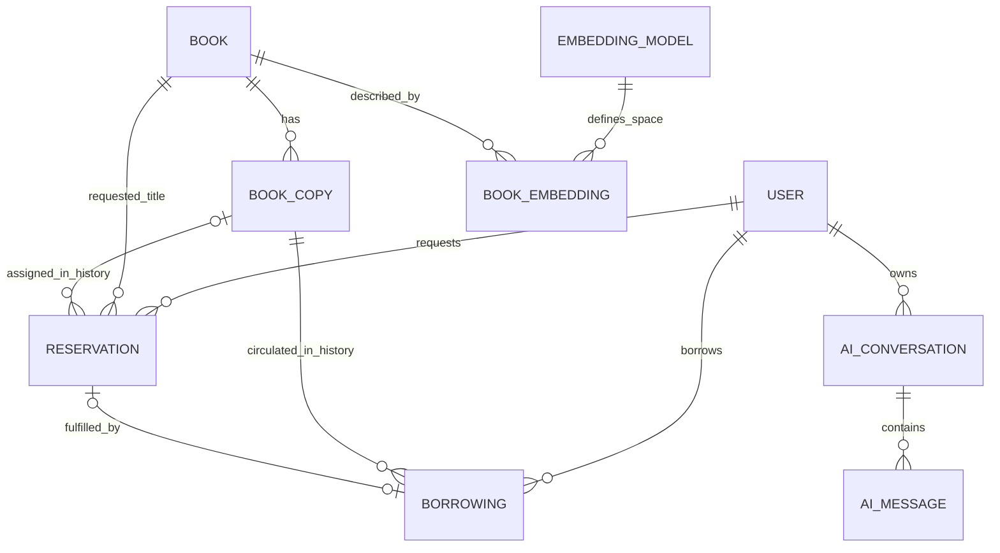

# Database architecture and operations

Current implementation: 27 domain/support tables, 16 enums, five applied revisions
through 0005_reservation_reminder. Final live PostgreSQL inspection verified
27 UUID primary keys, 48 foreign keys, 31 unique constraints, 60 checks and
144 indexes including Alembic (143 domain indexes). Every constraint is validated.
All date-time columns are timezone-aware; BOOK/COPY and reservation/loan ownership
relationships agree with persisted data. Runtime grants deny DDL and history edits.

PostgreSQL 17 uses vector 0.8.2 and pg_trgm 1.6. The selected embedding space
is E5 base at its pinned revision with 768 dimensions; 17 actual development
vectors matched that model/dimension at inspection. Seven settings are persisted.
Final gate: 358 backend tests plus one added assistant case, zero skips, with isolated fresh migration
upgrade/downgrade/re-upgrade, seed and drift checks. Development seed was rerun
without resetting data. Evidence: work/logs/final-live-schema.txt,
final-development-schema.txt, final-development-seed.txt and final-database.txt.
Application startup never creates tables or runs migrations.

Authority: Master Specification PARTS 13–28, 60, 73, 75, 117–125, 133, 137–161,
163–168, 183–188, 198–200 and the final database/security/AI reviews.

## Schema contract

[SCHEMA_REFERENCE.md](SCHEMA_REFERENCE.md) lists every column, foreign key,
check, unique constraint, enum value and additional index from model metadata.
It is generated documentation. A separate live catalog inspection verified
27 tables, 16 enums, 27 UUID primary keys, 48 foreign keys, 31 unique constraints,
60 checks and 143 domain indexes (85 additional plus 58 primary/unique constraint indexes).
The inspection also verified 10 triggers, timezone-aware timestamps and persisted
development data. The report distinguishes this evidence from metadata checks.

| Area | Tables |
|---|---|
| Identity | `users`, `refresh_sessions` |
| Physical catalog | `books`, `book_copies`, `authors`, `book_authors`, `categories`, `book_categories`, `publishers` |
| Circulation | `reservations`, `borrowings` |
| Reader engagement | `favorites`, `user_category_preferences`, `notifications` |
| Analytics sources | `user_interactions`, `search_events`, `recommendation_impressions` |
| Model spaces | `embedding_models`, `book_embeddings` |
| Category review | `category_prediction_runs`, `category_predictions`, `category_prediction_selections` |
| Assistant history | `ai_conversations`, `ai_messages`, `ai_message_books` |
| Administration | `system_settings`, `audit_logs` |

All 27 tables have UUID primary keys with Python and PostgreSQL generation.
Timestamps use `timestamptz`; a copy's acquisition date uses `date`. PostgreSQL
native enums represent roles, account/copy/reservation/loan states, interaction
types/sources, notification references, review states and setting/score types.

`BOOK` describes a title; `BOOK_COPY` describes one physical inventory item.
Availability is derived from eligible copy rows. There is no authoritative
availability counter or digital lending field. A copy inventory number and a
reservation QR credential are separate identifiers.



## Constraints and concurrency

- Unique normalized email, optional ISBN, inventory number, reservation display
  number, QR hash and refresh hash. Association, favorite and preference pairs
  cannot repeat. ISBN syntax is normalized; checksum validation belongs to the
  catalog input service. Historical publication years are allowed.
- Partial unique indexes allow at most one WAITING/READY reservation per
  user/book, one READY reservation per copy and one BORROWED/OVERDUE loan per
  copy. Each reservation can fulfill at most one borrowing.
- Composite foreign keys ensure the assigned copy belongs to the reserved book,
  a borrowing matches its reservation's user/copy, a notification belongs to its
  referenced reservation/loan owner and a recommendation click belongs to its
  impression's user/book.
- WAITING has no copy, hold dates or QR material. READY requires a copy, hold
  dates and hashed/encrypted credential fields. Terminal reservation states
  clear credential material while retaining history. QR is never a loan.
- Borrowing timestamps and returned/lost fields must match local state. Damaged
  copies cannot have a circulating status. An archived copy cannot be RESERVED
  or BORROWED. Date consistency, nonblank names, positive counts, finite scores
  and typed setting values have database checks.
- FIFO lookup uses `(book_id, reserved_at, id)` for WAITING rows. READY expiry,
  active loans/due dates, history, actor/event/date filters, copy allocation and
  reference lookups have dedicated indexes. `pg_trgm` GIN indexes cover book
  title/description and author/category/publisher names.

Reservation numbers use a database sequence (`R-...`) and may contain gaps;
they are display identifiers, not secrets or queue positions.

Database defenses complement the implemented service transactions. Reservation,
issue, return and scheduled workflows lock Book then Reader records before dependent
copy/reservation/loan rows, recheck eligibility, coordinate exclusivity and commit
state/events/audit atomically. FIFO, limits, overdue, role/ownership and separate QR
verification/explicit issue are enforced in services. Real PostgreSQL tests cover
same-copy and cross-book races, return/cancel, expiration and worker restart;
FINAL_ACCEPTANCE_MATRIX.md records executed evidence.

## Vector and AI storage

PART 60 requires benchmarking multilingual candidates before model selection.
PHASE 2 therefore uses pgvector `vector` with dimensions enforced by
`vector_dims(embedding) = dimension` and a composite foreign key to the immutable
model-space row. Different revisions/dimensions can coexist for measured model
migration. Name, revision, source recipe, normalization, configuration, source
hash and generation time preserve provenance. A book/model pair is unique;
zero vectors are rejected. Queries must select one compatible model space.

This is pgvector's documented [variable-dimension storage](https://github.com/pgvector/pgvector/tree/v0.8.2#can-i-store-vectors-with-different-dimensions-in-the-same-column).
PHASE 12 selected pinned multilingual E5 base, 768 dimensions, through actual
Kazakh/Russian/English evaluation. Live generated vectors and PostgreSQL cosine
queries were verified. The existing model B-tree index supports exact scanning;
an approximate index is not justified for the current small corpus. See
SEMANTIC_SEARCH.md for measured evidence, invalidation and safe re-embedding.

Prediction runs record source/model/configuration and staff review; individual
predictions reference real categories and distinguish probability, cosine and
decision-function scores. Nullable `accepted` distinguishes unreviewed from
rejected. The final selected-category set includes manual additions for honest
set-level review metrics. Conversations have owners; messages separate content
from safe tool metadata and record usage/error timing. Structured message-book
references have catalog foreign keys. Authorization, safe content filtering,
retention limits and real inference remain in their feature phases.

Recommendation impressions and clicks support deduplicated exposure attribution.
Feature services must record actual rendered exposures, not merely generated
results. No CTR or model effectiveness is supplied by these tables alone.
Notification event keys are unique per user. Concrete reference columns retain
foreign keys; `related_entity_id` is generated from the selected reference.

## Settings and history protection

Revision `0003_defaults_and_guards` inserts the original six values; revision
`0005_reservation_reminder` adds the pickup reminder threshold:

| Key | Default | Allowed value |
|---|---|---|
| borrow_period_days | 14 | Integer 1–365 |
| max_books_per_user | 5 | Integer 1–100 |
| reservation_hold_hours | 48 | Integer 1–8760 |
| return_reminder_days | 2 | Integer 0–365 |
| reservation_reminder_hours | 6 | Integer 0–8760; zero disables pickup reminders |
| block_borrowing_if_overdue | true | Boolean |
| block_reservation_if_overdue | true | Boolean |

These defaults are migration data. Future services must read settings from the
database; they must not copy defaults into business logic. Re-running upgrade
or the development seed does not intentionally reset edited settings.

History references restrict deletion of users, books, copies and taxonomy.
Use account inactivation or catalog archival; do not cascade operational history.
Dependent association rows, favorites, derived vectors and owned assistant
messages have deliberate cascade behavior where appropriate. Runtime privileges
permit deletion only for specifically listed mutable/derived records.

Audit UPDATE, DELETE and TRUNCATE are blocked by database triggers. Embedding
model provenance cannot be updated beneath existing vectors. Seven mutable
entities receive database-maintained `updated_at` values. Audit payloads and AI
metadata still need service-level secret filtering; JSONB is not a sanitizer.

Refresh sessions store only token hashes, expiry/revocation/consumption and
rotation-family lineage, with one successor per parent and same-family/user
foreign keys. PHASE 3 implements rotation, reuse revocation, cookies, CSRF,
RBAC and owned-session authorization on this schema. User row locks serialize
credential/session mutations; audits commit in the same transaction. Root IDs
identify sessions without exposing credential hashes. See AUTHENTICATION.md.

## Database roles

The explicit operator command uses the PostgreSQL image owner only to provision
roles, database/schema access and extensions. The non-superuser migrator owns
domain DDL. The distinct non-superuser application role has restricted table
privileges, no DDL or Alembic access, no history deletion and no audit mutation.
It can update setting values/actor/time, but cannot change validation metadata.

API and worker receive only runtime credentials through explicit Compose
environment mapping. They no longer inherit the whole `.env`. Owner/migration
credentials and the seed password are available only to the opt-in operator/test
services. Keep all three role passwords separate. A `DATABASE_URL` override must
also use the restricted application role.

## Apply and seed

For an existing PHASE 1 `.env`, run `python scripts/init_database_env.py`. It adds
missing local role/seed credentials, preserving nonempty values and printing no
secrets. For a fresh clone, use `python scripts/init_env.py` once instead.

Runtime configuration, from `C:\SmartLibrary`:

```powershell
docker compose config --quiet
docker compose build backend
docker compose up -d postgres redis --wait
docker compose run --rm database python -m app.db.manage upgrade
docker compose run --rm database python -m app.db.manage check
docker compose run --rm database python -m app.db.manage seed
docker compose up -d --build --wait --wait-timeout 180
```

For development, insert `-f docker-compose.yml -f docker-compose.dev.yml`
immediately after each `docker compose`. Build that backend target first. Apply
roles/migrations before restarting the API with restricted runtime credentials.
The two operator services are excluded from ordinary six-service startup by
profiles; `compose run database` explicitly selects the operator.

The optional seed refuses production, acquires a PostgreSQL advisory lock and
commits one transaction. A version marker preserves existing data on repeats.
It creates 6 accounts (`admin`, `librarian`, `reader1`–`reader4` at
`smartlibrary.example`), 10 categories, 12 curated titles, 24 physical copies,
READY/WAITING/history reservations, active/overdue/returned/lost loans, favorites,
preferences, labeled audit/search/interaction fixtures and two notifications.
These are development data, not actual library holdings or measured analytics.
Edition-specific ISBN/page counts are left absent when unknown.

The account password comes from private `DEV_SEED_PASSWORD`; Argon2id hashes are
generated normally. The READY fixture uses a random credential, SHA-256 hash
and Fernet encryption with the private QR key. No credentials are printed. Seed
accounts can now log in through PHASE 3 authentication. No synthetic AI
answers, embeddings, predictions or recommendation impressions are seeded.

## Real PostgreSQL verification

```powershell
docker compose --profile testing build database-tests
docker compose run --rm database-tests
```

The runner creates a unique `smartlibrary_test_<uuid>` database, applies the
schema, checks model drift, performs empty-database downgrade/upgrade, installs
runtime grants and runs pytest against real PostgreSQL. It drops only its own
new test database in cleanup. It never resets the development database. Failed
cleanup after an engine outage must be reviewed before manual removal.

PHASE 3's auth fixture creates a second uniquely named isolated database to test
committed HTTP transactions without changing PHASE 2's fixed seed expectations.
HTTP requests use the restricted application role. Auth tests use isolated Redis
key namespaces and delete only their own keys. Backend test databases are dropped
in cleanup. Browser E2E checks use development accounts and create visibly labeled
unique `phase3-e2e-...@example.com` readers; those accounts and their audit/session
history remain as development fixtures. Existing seed passwords are preserved.

The suite checks metadata/catalog parity, extensions, indexes, local constraints,
foreign keys, UUID/timestamp/enum types, QR/password seed material, vector/trigram
operations, settings, restricted roles, audit immutability, transaction rollback,
competing connections and locks. Native pytest explicitly skips database cases
without this isolated environment. SQLite, offline SQL rendering and model
inspection do not count as actual PostgreSQL verification.

The final PHASE 2 run passed 13 foundation/seed-guard cases and all 41 PostgreSQL-backed
cases, including the original 36 and five migration-comparison regressions.
Fresh-database upgrade, downgrade/re-upgrade and model drift checks passed.
Generated-expression changes fail explicitly; normal default/nullability drift
remains detectable, and inspecting the reservation default consumes no sequence
values. Development seeding ran twice and retained the same persisted fixture.

## PHASE 14 prediction records

Existing category_prediction_runs/category_predictions/category_prediction_selections
now persist actual model output and transactional review, including manual additions.
Same-set retries are idempotent; stale input/taxonomy requires regeneration. No new
migration. The 37-case affected PostgreSQL gate and isolated migration round trip passed.

## PHASE 15 owned conversations

Existing ai_conversations/ai_messages/ai_message_books store real turns, provider
failure metadata and FK-backed book references. UUID-derived request IDs prevent
duplicate successful turns. Pending turns use short row-locked admission/finalization
and recover after interruption. No schema change. No external calls under DB locks.
